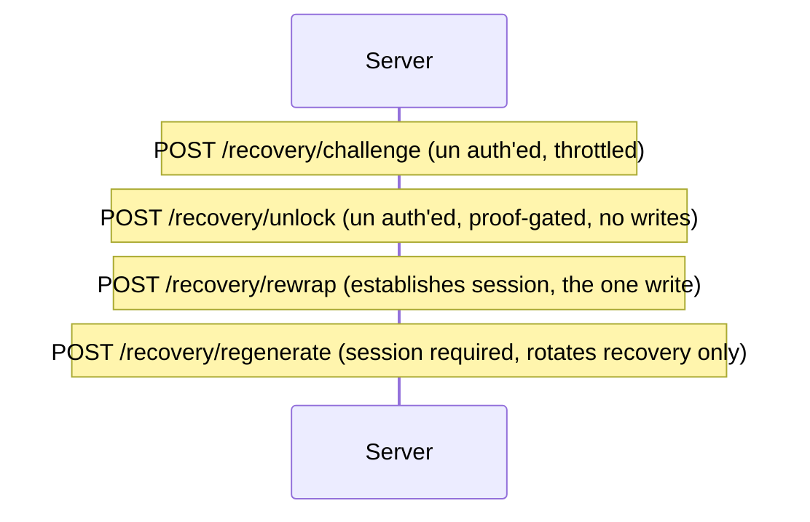

# Vault recovery flow (case 3) — end-to-end timeline

Case 3 = *stranded user*: no device key, master password forgotten, but holding the
recovery file. No user accounts exist: `vault.id` is the identity and the sole
session principal, so recovery has to (a) prove possession of an unforgeable
artifact, (b) leave the vault ciphertext, sync-version counters and the recovery
material valid, (c) rotate the password credential so the user can type a master
password again.

Conventions in the diagrams below:
- `U` user, `C` client, `S` server.
- `*vaultKeyRaw*` = raw 32-byte vault key (held in memory only).
- `K_rec` = `HKDF(recoverySecret, "recovery-wrap-v2", recovery_salt)`.
- `verifier` = `HMAC(secret-salt, "recovery-verify-v1")`. The *only* recovery
  material the server stores — never invertible.
- Rule R1: the recovery envelope wraps `vaultKeyRaw` **directly**, so rotating
  a password never severs recovery and the key that just recovered a vault keeps
  recovering it indefinitely.
- Three counters to keep separate: `version` (document CAS, sync),
  `credential_version` (password credential CAS), and the recovery verifier
  itself (CAS by value when rotated).

The companion ledger of what is implemented versus what is missing lives in
`SECURITY_AND_FEATURE_ROADMAP.md` ("Recovery and portable backup"). Invariants
and wire-contract details are in `AGENTS.md` ("Vault recovery (case 3)").

---

## 1. Creation — the file is created **before** any row exists

Registration is the *last* step, not the first: nothing may be persisted server-side
unless the recovery file is already in the user's hands. Reload halfway and
there is nothing to clean up.

```mermaid
sequenceDiagram
autonumber
actor U as User
participant C as Client
participant S as Server

U->>C: set master password
C->>C: prepareVaultFlow() — entirely local
Note over C: vault id, vault key, ciphertext
Note over C: password envelope (salt/PBKDF2/verifier + vault_key_wrap)
Note over C: recovery secret (160-bit, Crockford, no checksum)
Note over C: recovery_salt, K_rec, verifier, wrapped vault key (AAD=vaultId)
Note over C: PendingVaultRegistration holds everything incl. recoveryKey

C->>U: interstitial: Save your recovery file (Continue disabled)
rect rgb(40,30,40)
U->>C: tick "Save my recovery file" (or press Download) — download fires either way
C->>C: buildRecoveryPdf(payload) → voult-recovery-kit.pdf
C->>U: file downloaded (saved=true, confirmed=true)
end
C->>S: POST /register (one, irreversible write)
S-->>C: vault_id + OK
C->>S: GET /session (lock_epoch baseline)
C->>C: persistDeviceSecrets()  (device key enrolled only NOW)
C-->>U: vault open
```



Failure surfaces here: `VAULT_EXISTS` / network → retry reuses the *same*
prepared vault id and recovery key, so the already-saved PDF never gets
orphaned. Server rejected before commit → nothing exists server-side.
Reload at any point before Continue → no row, no session, no cleanup needed.

Note the PDF name is the constant `voult-recovery-kit.pdf` on purpose — a file
name lands in backup/search tool indexes, so no part of the vault id (or anything
else identifying) may appear in it. The vault id itself is printed inside the PDF
body (short form "Vault: 3f2c9d8e-…") so paper copies stay matchable.

---

## 2. Recovery — the two-screen flow

Entry routes for `/recover`: the public "Recover a vault" button (no vault
selected, `no_vault` state), the lock screen's "Forgot your master password?"
→ `/recover?recover=<vaultId>`, or a deep link honored by the bootstrap
`_layout.tsx`. The URL vault id is only a hint — **the file is authoritative**
(following §3) and guards against sending a key to the wrong vault.

Guard for both screens: `no_vault` or `locked`. Recovery is disallowed while
unlocked.

### 2a. Step 1 — prove possession, recover the raw key (no session yet)

```mermaid
sequenceDiagram
autonumber
actor U
participant C
participant S

C->>U: /recover: open your recovery file
U->>C: pick file
C->>C: readRecoveryFile → parseRecoveryPdf → (vaultId, recoveryKey)
C->>S: POST /recovery/challenge {vault_id}
S-->>C: {selector, challenge, expires_at} (10-min TTL)
C->>C: params = GET crypto params (recovery_salt, has_recovery)
C->>C: K_rec = deriveRecoveryWrapKey(secret, recovery_salt)
C->>C: proof = HMAC(verifier, "recovery-proof-v1|vault|challenge")
C->>S: POST /recovery/unlock {vault_id, selector, proof}
S-->>C: {recovery_wrap, recovery_wrap_iv, credential_version}
C->>C: unwrap(recovery_wrap, K_rec, AAD=vaultId) → vaultKeyRaw
C->>C: stash PendingRecovery{vaultId, verifier, vaultKeyRaw, credentialVersion}
C-->>U: /recover-password ("Step 2 of 2")
Note over C: nothing written, no session yet
Note over C: local KDF ran; all errors collapse to one undifferentiated 401-like message
```

On any failure (wrong key, expired challenge, unknown selector, unknown vault,
missing recovery) the server answers identically — 401 `AUTH_FAILED`, "Recovery
failed. Check the recovery key." — so no endpoint becomes an oracle. The only
deliberate exception is `/recovery/challenge`, which 404s `VAULT_NO_RECOVERY`,
but that leaks nothing because `GET /get_crypto_params` already exposes
`has_recovery`. Client-side actionable states surface before this uniform
surface: `INVALID_RECOVERY_KEY` (bad shape), `RECOVERY_NOT_ENABLED`,
`RECOVERY_FAILED` (unwrap failed).

### 2b. Step 2 — choose a new master password, open the vault

```mermaid
sequenceDiagram
autonumber
actor U
participant C
participant S

C->>U: /recover-password (ready? → else "Start over")
U->>C: new password + confirm (≥8 chars)
C->>C: derivePasswordKeys(newPassword, newSalt, iter)
C->>C: wrap vaultKeyRaw → new envelope
C->>C: unwrap(new envelope) MUST equal vaultKeyRaw (local verification)
Note over C: typo in new password is caught here, for free
C->>S: POST /recovery/challenge {vault_id}  (FRESH, defeats TTL expiry mid-input)
C->>S: POST /recovery/rewrap {selector, proof, credential_version, new_*}
S->>S: verify + burn challenge, CAS credential_version++, rotate password credential
S-->>C: establish session cookie; {vault_id, crypto_version, lock_epoch}
C->>S: GET /api/vault → decrypt with recovered key
C->>C: persistDeviceSecrets(vaultKeyRaw)
C->>C: switchVaultOpen() (atomic selection+session+key+doc+version)
C->>C: initSQLite(vaultId); upsertVaultId; upsertVaultVersion; wipe raw key
C-->>U: /
```

`completeRecovery` keeps `PendingRecovery` (including `credential_version`
carried across the screen boundary — a vault already recovered once would 409
`CREDENTIAL_STALE` if it defaulted to 0), verifies locally, then performs the
one irreversible write. `abandonPendingRecovery()` clears the in-memory state in
`finally` on any outcome. Direct-navigation/reload with no pending state renders
"Start over" rather than failing.

---

## 3. Wire contract — what each write touches

Legacy-shaped local copy of the server-side column discipline:

```
rewrap   (paths 2b)   touches:  salt, iterations, verifier_*, vault_key_wrap*,
                                      credential_version (+1)
                  untouches:  vault, vaultiv (ciphertext), version (document CAS),
                              recovery_* (Rule R1), lock_epoch
```



Three counters, three semantics:
- `version` — document CAS, bumps on vault sync. **Untouched** by recovery.
- `credential_version` — password-credential CAS. Bumped by `rewrap`, and
  compared exactly in concurrent races (→ 409 `CREDENTIAL_STALE`).
- `recovery_verifier` — compared **by value** on rotate, so no separate number is
  needed; two rotations racing yield 409 `RECOVERY_STALE`.

Failure/to uniformity summary:
- 401 `AUTH_FAILED` for wrong proof, expired challenge, unknown selector,
  wrong vault, or no-recovery vault in the unlock path.
- 404 `VAULT_NO_RECOVERY` at `/challenge` for unknown/unrecoverable vault.
- 409 `CREDENTIAL_STALE` (already recovered elsewhere) at `rewrap`.
- 409 `RECOVERY_STALE` (already rotated) at `regenerate`.
- `UNSUPPORTED_CRYPTO_VERSION` if the vault isn't on crypto version 2 yet.
- Challenge TTL 10 min; max 3 live challenges per vault; `ChallengeThrottle`
  10/60s per client IP. Challenge burnt inside the transaction so a failed
  proof rolls the burn back and the same challenge remains usable.

---

## 4. Rotation — replacing a lost/exposed file (Settings)

Session-required by design. The user proves possession of the *current* file
first; only then does a new one issue.

```mermaid
sequenceDiagram
autonumber
actor U
participant C
participant S

C->>U: Settings → Recovery file → Rotate
U->>C: select current file
C->>C: readRecoveryFile + verify vaultId matches this vault
C->>S: POST /recovery/challenge
C->>S: POST /recovery/unlock  (release envelope)
C->>C: unwrap → vaultKeyRaw (used only inside this flow)
C->>C: generate newSecret, newSalt, newK, newVerifier  (all local)
C->>C: wrapKeyBytes(vaultKeyRaw, newK, AAD=vaultId)  (Rule R1: direct)
C->>S: POST /recovery/regenerate (selector, proof, new_*)  [session required]
S->>S: CAS on recovery_verifier; swap recovery_* columns only
S-->>C: {rotated}
C->>C: formatRecoveryKey(newSecret)  → string; zero secret bytes
C->>U: NEW ONE-TIME PDF; Continue (save/confirm) → Done
```

Properties preserved: does not touch password columns or `credential_version`;
old file stops working the moment the new one is committed; delivery is once
only (no "re-generate" / replay) because a stolen session must not be able to
force-rotate. Recovery-format rendering of the secret happens once and is then
zeroed in memory.

---

## 5. The recovery file format (owned PDF) at a glance

```mermaid
flowchart LR
    A[Payload vaultId + key] --> B[Page content stream: 5 lines Courier/Courier-Bold]
    A --> C[Info /Subject tagged payload]
    B --> D[Uncompressed PDF-1.4 stream]
    C --> D
    D --> E[voult-recovery-kit.pdf]
    E -->|read| F{parseRecoveryPdf}
    F -->|raw scan| G[tagged payload]
    F -->|inflate each stream| H[re-encoded copy read via DecompressionStream]
    G --> I{exactly one key?}
    H --> I
    I -->|0| J[RECOVERY_FILE_NO_PAYLOAD]
    I -->|>1| K[RECOVERY_FILE_AMBIGUOUS]
    I -->|1<|message|> L[verified vault id + parseRecoveryKey]
```

Machinery that **stayed** by design: inflation over every stream with both
`deflate`/`deflate-raw` and both framing variants (so a re-saved/rewritten PDF
still reads — that path is exercised by the poppler and ghostscript tests);
size guards and the undifferentiated error vocabulary. Removed in the recent trim:
hex-string decoding of `<…>` text; the bare-UUID / bare-key fallback that guessed
at unidentified producer encodings. A file that still fails after these rescues is
reported as *"It needs to be the original file you saved"* rather than guessed at.
Print-outs and re-scanned pages deliberately do **not** import, and reading is
file-only — there is no typed-key fallback on either direction (recover or
rotate).

---

## 6. Invariants worth not breaking

- A `vault` row must never exist without the user already holding its recovery
  file. Creation order is the load-bearing part of the recovery story.
- Recovery leaves `vault`/`vaultiv` ciphertext and `version` alone. It rotates
  `credential_version` only at `rewrap`, and a separate `recovery_verifier`
  at `regenerate`.
- Challenge flows are unsigned: every proof failure returns the identical
  shape; throttling is app-scoped (outside `HttpServer::new`).
- Challenge consumption happens inside the transaction, on the success path
  only, so a bad proof is retriable.
- Rotation proves the current file; no replay; no password action required to
  rotate.
- `PendingRecovery` (including `credential_version` and the verifier, not the
  secret) lives only in process — never in the store, never on disk.
- Cross-vault safety: epoch capture (`captureSelectionEpoch`) rather than id
  equality on every async success path.
- All recovery I/O goes through `parseRecoveryPdf`/`buildRecoveryPdf` in
  `packages/vault-core/src/recovery-pdf.ts`; AAD is `recoveryAad(vaultId)`.
- No plaintext ever crosses: verifier (hash), ciphertext envelopes only.

---

## 7. Restore from a provider backup keeps the same recovery key

A vault's recovery material is a property of the **vault**, not of whichever
server row happens to exist, so it travels in the backup. The `VoultPackage`
carries a `recoveryEnvelope` (salt, verifier, wrap, wrap iv) alongside the
password envelope (`apps/server/src/cloud/package.rs`,
`apps/client/src/lib/state/type.ts`; `PACKAGE_FORMAT_VERSION = 2`).

`importVaultFromCloud` therefore does **not** mint a recovery key and shows **no
interstitial**: it verifies the master password locally, then registers the row
with the package's exact recovery values (`apps/client/src/lib/vault/import.ts`).
The file the user saved at creation keeps opening the vault on the new instance —
one `vaultId`, one recovery file, everywhere.

Because the mirror re-serializes the row every time
(`cloud/mirror.rs` → `cloud/package.rs::build`), a rotation issued on any instance
is reflected in the next backup, and `build` now refuses a row with no recovery
material (`ERR_MISSING_RECOVERY`) rather than writing a backup that would restore
into a different recovery key.

Trade-off accepted: a provider backup *plus* the recovery file together can
unwrap `vaultKeyRaw` without the server. The server's zero-knowledge boundary is
unchanged (it still holds ciphertext only), and the recovery envelope is an
AES-GCM box under a 160-bit random key, not something offline-crackable.

Entry/run links: `lib/auth/flows/recover.ts`, `pages /recover`,
`/recover-password`, `lib/settings/recovery-key-section.tsx`, and the server
`endpoints/recovery.rs` (`ChallengeThrottle`).
