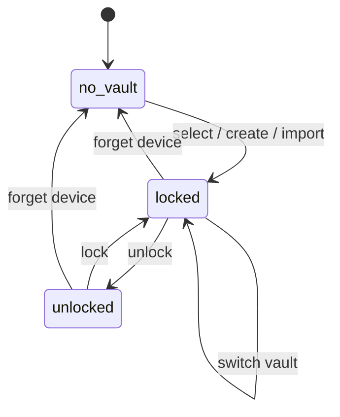
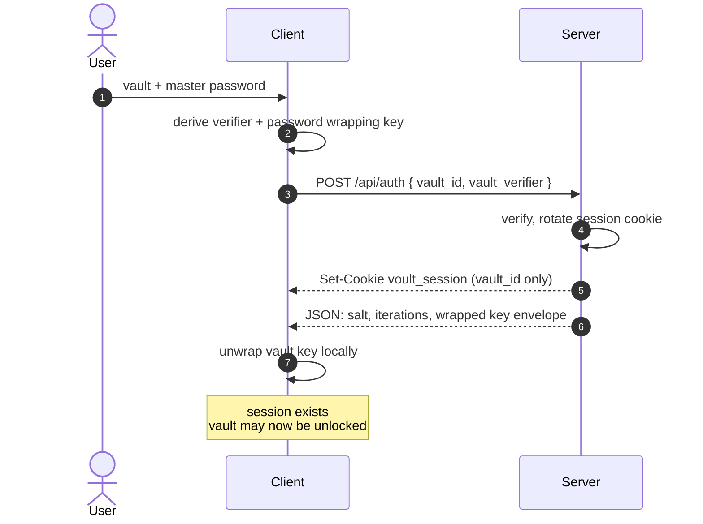
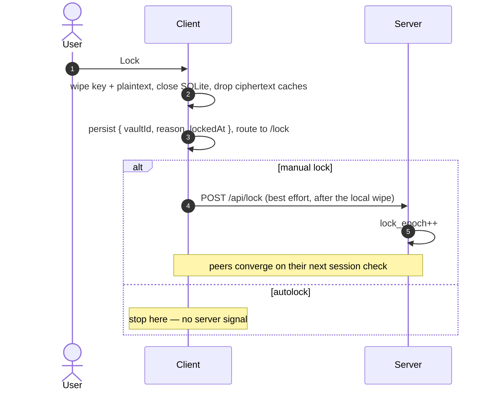
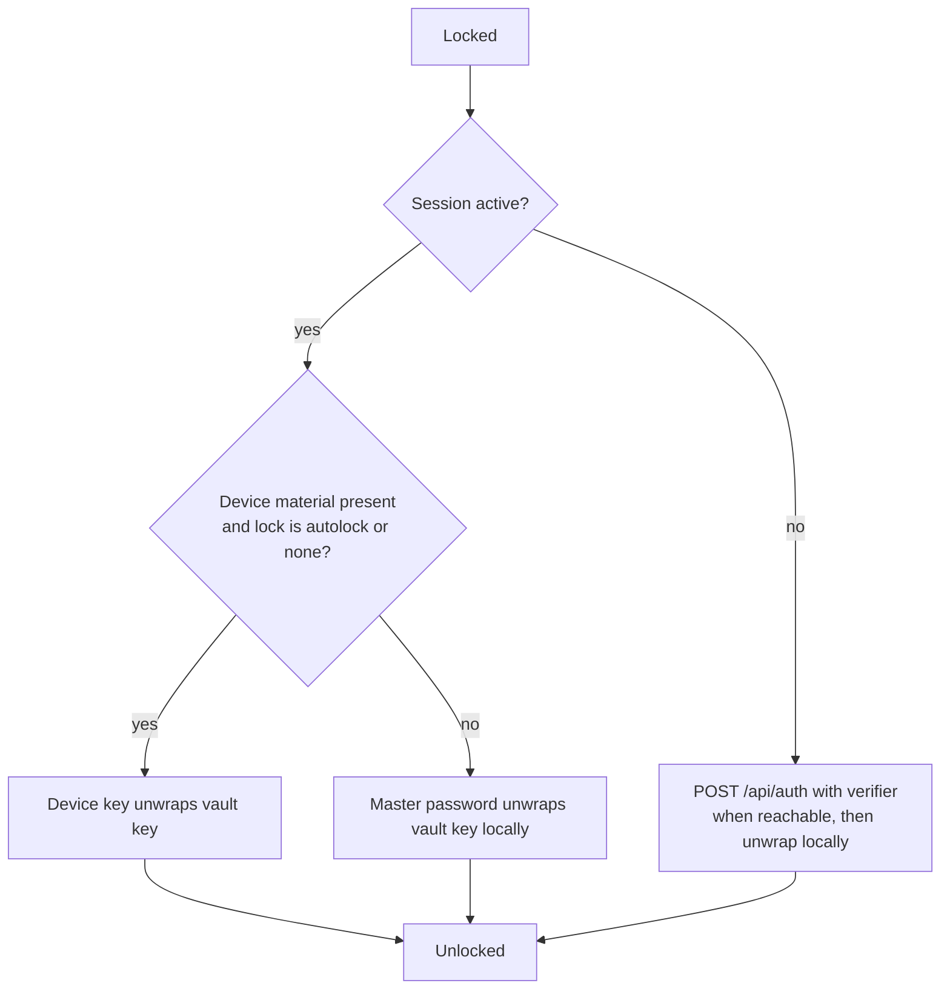
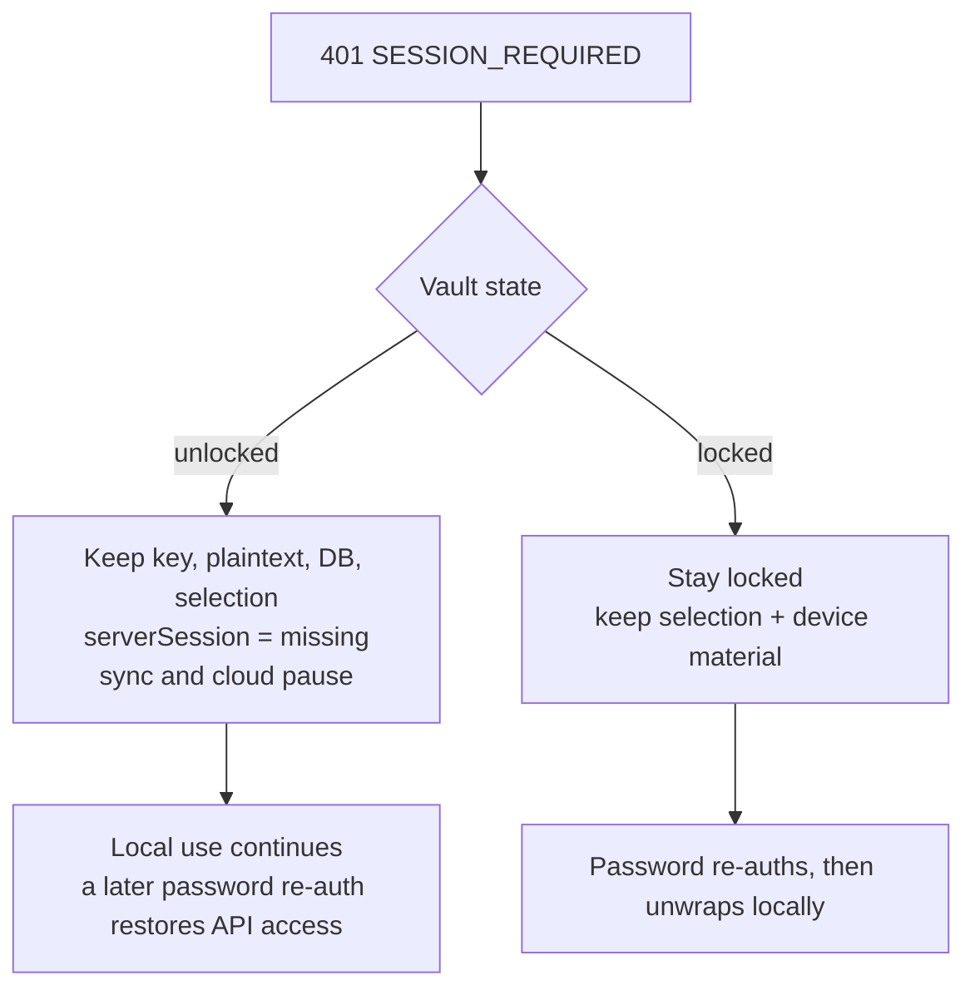
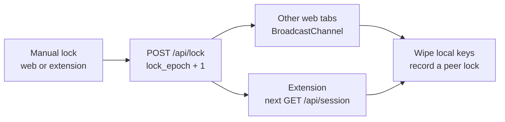
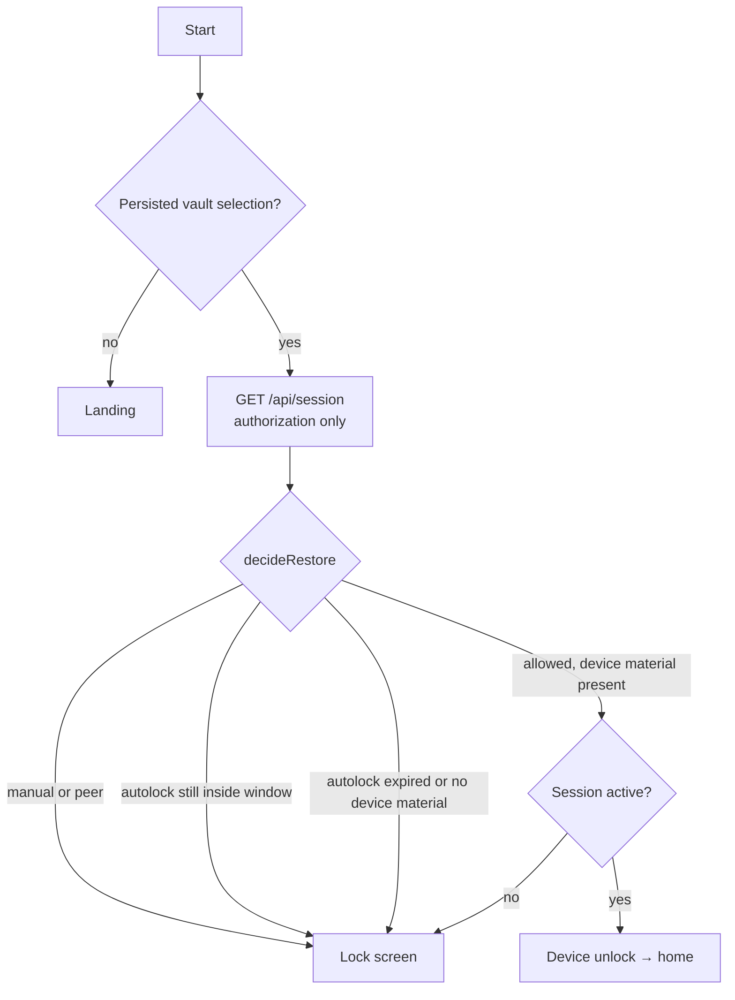

# Sessions and locking

Voult has no accounts. There is no user row, no email, no "logged-in user". The
vault is the entity: `vault.id` is a client-generated UUID, and it is the only
identity shared by the client, the server, and local storage.

Every server-side record is scoped to a `vault_id`; there is no `user_id`
anywhere. This changes what a session means. **A Voult session is not "the user
is logged in". It is permission for this browser or extension to act on one
vault's ciphertext.** The cookie holds no key, and the session says nothing
about whether the vault is open.

## Three independent facts

| Fact | Values | Where it lives | Question it answers |
|---|---|---|---|
| Vault state | `no_vault` / `locked` / `unlocked` | client memory + `localStorage` selection | Is the vault key in  |
| Server session | `unknown` / `active` / `missing` | HttpOnly `voult_session` cookie | May this client call the API? |
| Availability | `unknown` / `available` / `unavailable` | server row | Does the vault still exist? |

Never infer one from another:

- A valid session does not mean the vault is open.
- A locked vault does not mean the session ended.
- A missing session does not mean the vault is locked or deselected. An
  unlocked vault stays usable locally; only sync and cloud work pause.
- Unlocking is not sign-in. Most unlock paths are purely local; the one path
  that also creates a session is the explicit password re-auth on the lock
  screen (or a fresh login).

Local-first is why this split matters: losing server access must not destroy
local access. A cookie can be renewed and the vault key can be re-derived, but
neither is allowed to erase the user's selection or their device unlock material.

A `401 SESSION_REQUIRED` is deliberately absent from this diagram: it changes
`serverSession`, never `VaultState`.

## What a session is, and is not

| A session is | A session is not |
|---|---|
| a bearer capability for one vault | proof that the vault is unlocked |
| an HttpOnly, stateless, encrypted cookie | the vault key, device key, or master password |
| replaceable by re-authenticating with the password | a user account |
| held by one browser profile (but copyable until TTL) | a lock state |

The server stores ciphertext, salt, iterations, the password verifier, the
password-wrapped vault key, recovery material, `version`, and `lock_epoch`. It
never stores plaintext, the master password, the vault key, or the device key.
The device key and its vault-key envelope live in local IndexedDB.

Recovery material, device unlock material, sync state, and lock state are all
properties of the vault — not properties of a person.

The cookie is stateless (`CookieSessionStore`); the `session` table is unused.
Its default TTL is 7 days idle. `/api/logout` only clears the caller's cookie — a
copied cookie stays valid until TTL, because there is no server-side revocation
list.

## Password login / re-authenticate

Only the verifier crosses the wire; the password and vault key stay local.

Creating a vault ends the same way: `POST /api/register` is the last step and
establishes the session after the vault exists.

## Lock

Locking is a local decision: remove the key from memory. It is not a logout, and
it does not touch the session cookie.

The local wipe happens before any network call. A failed `/api/lock` never
leaves this vault open; peers just may not learn about the lock until a later
successful publish.

Lock reasons are durable: `manual` and `peer` hold across a restart until an
explicit unlock; `autolock` may lapse once its window passes. An expired session
is never a lock reason.

## Unlock

There are three ways back in, and all of them unwrap the key locally.

A wrong password fails at AES-GCM locally, not at the server, whenever the
session is still valid.

## Session expiry is not a lock

Neither branch writes a lock record. The cookie is an authorization fact; it
does not own the user's lock decision.

## Session checks

There is no interval poller. The web checks on focus, visibility, and network
reconnect; the extension checks on popup open, before filling, and on its slow
alarm tick. `GET /api/session` returns `vault_id`, `crypto_version`, and
`lock_epoch`.

- Different `vault_id` → another surface switched vaults. Drop this selection
  (the web returns to the chooser); the other vault is never auto-unlocked.
- Newer `lock_epoch` → a peer deliberately locked; wipe keys and record a
  `peer` lock.
- `401` → session lost, handled above.
- Transport error → change nothing; offline is normal.
- No local epoch yet → adopt the server epoch without wiping.

## Locking across surfaces

Only a deliberate manual lock is global. Idle locks are local because the web
app and extension have independent timeouts.

Unlock never propagates and never bumps `lock_epoch`. Each surface re-unwraps
locally with its own password or device key.

## Restart

The persisted selection, the lock policy, and the cookie each decide a different
thing.

`decideRestore()` is the single policy function. A missing cookie can stop the
fetch a device unlock needs, but it never erases the selection, deletes device
material, or rewrites the lock record. With Auto-lock set to Never, an ordinary
restart restores unlocked; a manual lock still does not.

## Rules to preserve

- Lock the vault locally before talking to the network.
- Do not treat the cookie as identity, as a key, or as a lock.
- Do not clear the selection, delete device material, or write a lock record on
  `401`.
- Do not publish idle/timer locks through `/api/lock`.
- Do not propagate unlocks.
- Do not put keys, envelopes, or plaintext in the session cookie or a server
  session record.
- Do not use the server as a session revocation list without changing the
  session design; today's cookie is a bearer capability until it expires.

## Where it lives

| Concern | Primary code |
|---|---|
| Vault state model + restore policy | `apps/client/src/lib/state/vault-state.ts` |
| Local selection + lock records + activity | `apps/client/src/lib/state/selection-store.ts` |
| Single lock path | `apps/client/src/lib/auth/lock.ts` |
| Autolock timer | `apps/client/src/lib/auth/use-autolock.ts` |
| Session sync + 401 handling | `apps/client/src/lib/sync/use-session-sync.ts`, `apps/client/src/lib/auth/teardown.ts` |
| Same-origin tab broadcast | `apps/client/src/lib/sync/session-channel.ts` |
| Cookie payload + rotation | `apps/server/src/session_auth.rs` |
| Session probe + lock epoch | `apps/server/src/endpoints/session_status.rs`, `apps/server/src/endpoints/lock.rs` |
